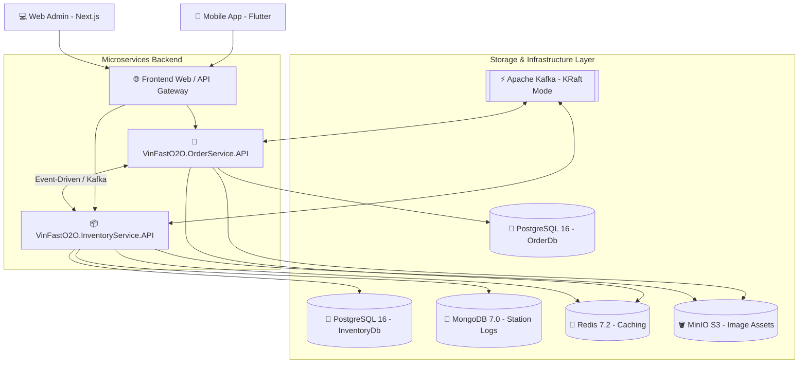

# 🚗 VinFast O2O (Online-to-Offline) Ecosystem

[](https://dotnet.microsoft.com/)
[](https://nextjs.org/)
[](https://reactjs.org/)
[](https://flutter.dev/)
[](https://www.postgresql.org/)
[](https://www.mongodb.com/)
[](https://redis.io/)
[](https://kafka.apache.org/)
[](https://www.docker.com/)

**VinFast O2O** là hệ thống Online-to-Offline toàn diện dành cho việc quản lý dịch vụ, kho phụ tùng/pin xe điện và hỗ trợ đặt lịch, thuê/thay pin cho hệ sinh thái xe điện VinFast. Hệ thống kết nối liền mạch giữa nền tảng trực tuyến (Web Admin/Customer Portal, Mobile App) và hạ tầng vận hành trực tiếp (Showroom, Trạm dịch vụ, Kho hàng).

---

## 🏗️ Kiến trúc Hệ thống (System Architecture)

Dự án được thiết kế theo mô hình **Microservices** áp dụng chuẩn **Clean Architecture (Onion Architecture)** và **Domain-Driven Design (DDD)** kết hợp cơ chế truyền nhận sự kiện không đồng bộ (**Event-Driven Architecture**) qua Apache Kafka.



---

## 🛠️ Công nghệ Sử dụng (Tech Stack)

### 1. Backend Services (.NET 8 Web API)
* **Kiến trúc:** Clean Architecture (Domain, Application, Infrastructure, API).
* **Quản lý Đơn hàng (`OrderService`):** Đặt lịch dịch vụ, đặt cọc xe/pin, thanh toán (VNPay), phân quyền RBAC, CMS tin tức/FAQ, Outbox Pattern.
* **Quản lý Kho (`InventoryService`):** Tồn kho phụ tùng (Pin VF8, lốp, động cơ...), POS Showroom, theo dõi log trạm pin.
* **Libraries & Frameworks:** Entity Framework Core 8, MediatR, FluentValidation, MassTransit/Kafka, StackExchange.Redis.

### 2. Frontend Web Application (Next.js & React)
* **Framework:** Next.js 16 (App Router), React 19, TypeScript.
* **Styling & UI:** Tailwind CSS v4, Lucide Icons, Chart.js.
* **Tính năng:**
  * **Customer Portal:** Xem sản phẩm xe/pin, đặt cọc trực tuyến, tra cứu đơn hàng, tin tức & hỗ trợ.
  * **Admin Dashboard:** Quản lý đơn hàng, quản lý kho/sản phẩm, quản lý bài viết/FAQ, nhật ký Audit Logs, báo cáo phân tích pin.

### 3. Mobile Application (Flutter)
* **Framework:** Flutter (Dart).
* **Tính năng:** Dành cho chủ xe điện đặt lịch bảo dưỡng, tìm kiếm trạm pin khả dụng gần nhất và theo dõi tiến trình dịch vụ thời gian thực.

### 4. Hạ tầng & Cơ sở dữ liệu (Infrastructure)
* **Relational Database:** PostgreSQL 16 (Port `5433`).
* **Document Database:** MongoDB 7.0 (Port `27017`).
* **Cache:** Redis 7.2 (Port `6379`).
* **Message Broker:** Apache Kafka 7.6 KRaft Mode (Port `9092`).
* **Object Storage:** MinIO S3 Compatible (Port `9000` & Console `9001`).
* **Big Data & Analytics:** Apache Spark.
* **Containerization:** Docker, Docker Compose, Kubernetes (K8s).

---

## 📂 Cấu trúc Thư mục Dự án

```text
VinFastO2O/
├── src/                                     # Backend Microservices (.NET 8)
│   ├── VinFastO2O.OrderService.API/         # API Endpoint Order Service
│   ├── VinFastO2O.OrderService.Application/ # Business Logic & Use Cases
│   ├── VinFastO2O.OrderService.Domain/      # Entities, Aggregates & Domain Events
│   ├── VinFastO2O.OrderService.Infrastructure/# Persistence, Repositories, EF Core
│   ├── VinFastO2O.InventoryService.API/     # API Endpoint Inventory Service
│   ├── VinFastO2O.InventoryService.Application/
│   ├── VinFastO2O.InventoryService.Domain/
│   └── VinFastO2O.InventoryService.Infrastructure/
├── web/                                     # Web Admin & Customer Portal (Next.js)
│   ├── src/app/                             # App Router (Client & Admin pages)
│   ├── src/components/                      # Shared UI Components
│   └── src/context/                         # Auth & App State Contexts
├── mobile/                                  # Mobile App (Flutter)
├── docker-init/                             # Database initialization scripts
├── k8s/                                     # Kubernetes deployment manifests
├── spark/                                   # Apache Spark analytics jobs
├── docker-compose.yml                       # Multi-container Orchestration
├── erd_viewer.html                          # Sơ đồ ERD tương tác (Mermaid)
└── README.md                                # Tài liệu hướng dẫn dự án
```

---

## ⚡ Hướng dẫn Khởi chạy Dự án (Getting Started)

### 📋 Yêu cầu tiên quyết (Prerequisites)
* **Docker Desktop** (khuyên dùng để chạy toàn bộ hạ tầng).
* **.NET 8.0 SDK** trở lên.
* **Node.js 20+** & `npm`.
* **Flutter SDK** (nếu muốn chạy ứng dụng Mobile).

---

### 1. Khởi chạy toàn bộ Hạ tầng & Backend bằng Docker Compose

Chạy một lệnh duy nhất tại thư mục gốc dự án để khởi chạy toàn bộ Database, Message Broker, MinIO và 2 dịch vụ Microservices Backend:

```bash
docker-compose up -d --build
```

#### 🌐 Danh sách Cổng kết nối & Dịch vụ:
| Dịch vụ | Loại | Port | Ghi chú / Đường dẫn |
| :--- | :--- | :--- | :--- |
| **Order Service API** | Backend | `5022` | `http://localhost:5022/swagger` |
| **Inventory Service API** | Backend | `5186` | `http://localhost:5186/swagger` |
| **PostgreSQL** | Relational DB | `5433` | User: `hvk2k5`, Pass: `odoopwd` |
| **MongoDB** | Document DB | `27017` | `mongodb://localhost:27017` |
| **Redis** | Cache | `6379` | `localhost:6379` |
| **MinIO Console** | S3 Storage | `9001` | User: `minioadmin`, Pass: `minioadminpassword` |
| **Apache Kafka** | Broker | `9092` | `localhost:9092` |

---

### 2. Khởi chạy Web Frontend (Next.js)

1. Di chuyển vào thư mục `web`:
   ```bash
   cd web
   ```
2. Cài đặt thư viện (nếu chạy lần đầu):
   ```bash
   npm install
   ```
3. Khởi chạy máy chủ phát triển:
   ```bash
   npm run dev
   ```
4. Truy cập Web tại: [http://localhost:3000](http://localhost:3000)
   * **Trang khách hàng:** `http://localhost:3000`
   * **Trang quản trị (Admin):** `http://localhost:3000/admin/login`

---

### 3. Khởi chạy ứng dụng Mobile (Flutter)

1. Di chuyển vào thư mục `mobile`:
   ```bash
   cd mobile
   ```
2. Lấy các gói phụ thuộc:
   ```bash
   flutter pub get
   ```
3. Chạy ứng dụng trên thiết bị giả lập hoặc máy thật:
   ```bash
   flutter run
   ```

---

## 🗄️ Cơ sở Dữ liệu & Sơ đồ ERD

Dự án bao gồm 14 bảng cốt lõi nằm trong cơ sở dữ liệu `VinFastO2O_OrderDb_Dev` (PostgreSQL):
* **Đơn hàng & Thanh toán:** `orders`, `order_items`, `payments`
* **Người dùng & Quản trị RBAC:** `users`, `AdminUsers`, `AdminRefreshTokens`, `Roles`, `Permissions`, `AdminUserRoles`, `RolePermissions`
* **Nội dung & Hỗ trợ:** `articles`, `faqs`
* **Phân tích Pin & Outbox Pattern:** `battery_health_reports`, `outbox_events`

👉 Để mở sơ đồ ERD trực quan, bạn có thể nhấp đúp vào file [`erd_viewer.html`](file:///d:/KLTN/erd_viewer.html) trực tiếp trên máy tính để xem tương tác trên trình duyệt.

---

## 📄 Giấy phép (License)

Dự án được phát triển phục vụ cho **Khóa luận tốt nghiệp ngành Công nghệ Thông tin / Kỹ thuật Phần mềm**. Mọi quyền được bảo lưu.
