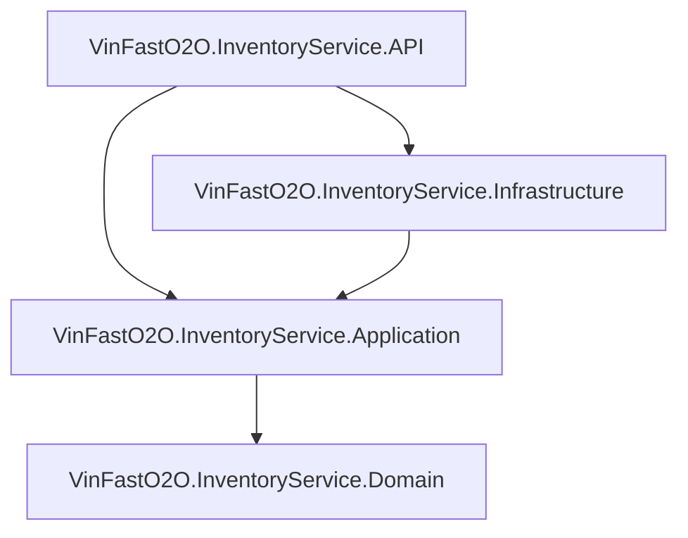

# VinFastO2O.InventoryService

Cấu trúc Solution .NET 8 Web API áp dụng chuẩn Clean Architecture (Architecture Clean/Onion).

## 🏗️ Cấu trúc Thư mục & Dự án

```text
VinFastO2O.InventoryService/
├── src/
│   ├── VinFastO2O.InventoryService.Domain/         # Lớp Domain (Thực thể, Value Objects, Domain Exceptions)
│   ├── VinFastO2O.InventoryService.Application/    # Lớp Application (Interfaces, DTOs, Services, Business Logic)
│   ├── VinFastO2O.InventoryService.Infrastructure/ # Lớp Infrastructure (Persistence, Services ngoài, In-Memory DB)
│   └── VinFastO2O.InventoryService.API/            # Lớp API (Endpoints, Middleware, Configuration)
├── VinFastO2O.InventoryService.sln                 # File Solution liên kết các dự án
└── .gitignore                                      # Cấu hình bỏ qua các tệp không cần thiết của git
```

## 🔄 Luồng Phụ thuộc (Dependency Flow)

Theo chuẩn Clean Architecture, các lớp bên ngoài phụ thuộc vào các lớp bên trong. Các lớp bên trong không biết gì về các lớp bên ngoài:



- **Domain**: Không phụ thuộc vào bất kỳ dự án nào khác. Chứa các thực thể cốt lõi (`InventoryItem`) và các logic quy tắc nghiệp vụ.
- **Application**: Chỉ phụ thuộc vào `Domain`. Định nghĩa các Interface (`IInventoryRepository`, `IInventoryService`), DTOs và xử lý Business Logic.
- **Infrastructure**: Phụ thuộc vào `Application` (và kế thừa `Domain`). Triển khai các Interface kỹ thuật (ví dụ: `InMemoryInventoryRepository` làm giả lập dữ liệu, hoặc sau này là EF Core kết nối DB).
- **API**: Phụ thuộc vào `Infrastructure` và `Application`. Đóng vai trò làm điểm tương tác bên ngoài thông qua các Minimal API Endpoints tiện dụng.

## 🚀 Hướng dẫn Chạy ứng dụng

### 📋 Yêu cầu hệ thống
- Cần cài đặt **.NET 8 SDK** hoặc cao hơn để biên dịch và chạy dự án (Các dự án đã được định cấu hình đích đến `net8.0`).

### ⚙️ Lệnh khởi chạy
Để khôi phục các gói và khởi chạy API:

1. Di chuyển vào thư mục dự án API:
   ```bash
   cd src/VinFastO2O.InventoryService.API
   ```

2. Khởi chạy dự án:
   ```bash
   dotnet run
   ```

3. Truy cập Swagger UI tại:
   `http://localhost:<port>/swagger` hoặc `https://localhost:<port>/swagger` (Port cụ thể được cấu hình trong `Properties/launchSettings.json`).

## 🛠️ API Endpoints có sẵn (Mock)
Dự án đã được tích hợp sẵn dữ liệu giả lập (In-Memory) phục vụ quản lý phụ tùng xe VinFast (như Pin VF8, Lốp VF9, Động cơ VF e34):
- `GET /api/inventory`: Lấy toàn bộ danh sách phụ tùng trong kho.
- `GET /api/inventory/{id}`: Chi tiết phụ tùng theo ID.
- `GET /api/inventory/sku/{sku}`: Tìm kiếm phụ tùng bằng mã SKU (Ví dụ: `VF8-BAT-001`).
- `POST /api/inventory`: Thêm mới phụ tùng vào kho.
- `PUT /api/inventory/{id}/quantity`: Cập nhật số lượng của phụ tùng.
